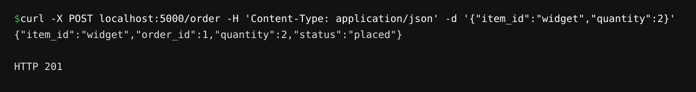
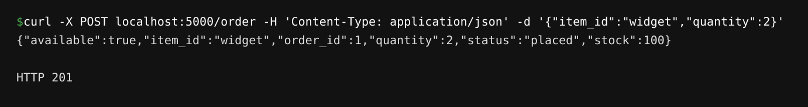
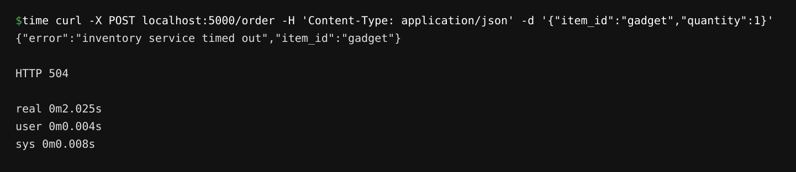
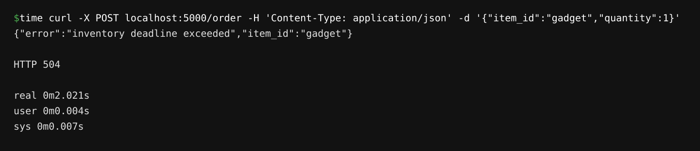
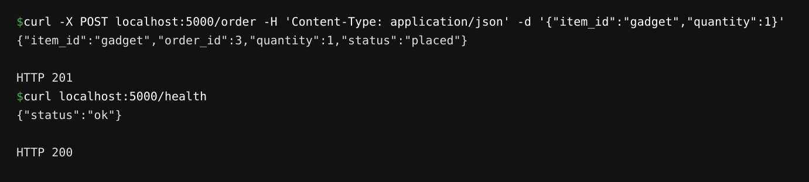

# CMPE-273 Module 3 Assignment: Order Service ↔ Inventory Service

Two services with the same contract, implemented twice: once over REST/HTTP, once over gRPC.

- **Order Service** — accepts orders (`item_id`, `quantity`) at `POST /order`.
- **Inventory Service** — checks item availability. Stock: `widget: 100, gadget: 50, gizmo: 0`.

## Setup

```bash
pip install -r requirements.txt
```

For the gRPC version, generate the stubs once:

```bash
cd grpc
python -m grpc_tools.protoc -I. --python_out=. --grpc_python_out=. inventory.proto
```

## Running the REST version

Terminal 1 — Inventory Service (port 5001):

```bash
python rest/inventory_service.py
```

Terminal 2 — Order Service (port 5000, 2s timeout on the inventory call):

```bash
python rest/order_service.py
```

## Running the gRPC version

Terminal 1 — Inventory Service (port 50051):

```bash
cd grpc
python inventory_server.py
```

Terminal 2 — Order Service (port 5000, 2s gRPC deadline):

```bash
cd grpc
python order_service.py
```

## Successful REST request/response

```bash
$ curl -X POST localhost:5000/order -H 'Content-Type: application/json' \
    -d '{"item_id":"widget","quantity":2}'
```

```json
{"item_id":"widget","order_id":1,"quantity":2,"status":"placed"}
```
HTTP 201. Error cases: unknown item → 404, insufficient stock → 409.



## Successful gRPC request/response

```bash
$ curl -X POST localhost:5000/order -H 'Content-Type: application/json' \
    -d '{"item_id":"widget","quantity":2}'
```

```json
{"available":true,"item_id":"widget","order_id":1,"quantity":2,"status":"placed","stock":100}
```
HTTP 201. Error cases use gRPC statuses: unknown item → `NOT_FOUND`, insufficient stock → `RESOURCE_EXHAUSTED`.



## REST timeout handling

With `INVENTORY_DELAY=5` on the Inventory Service (delay > 2s timeout):

```bash
$ time curl -X POST localhost:5000/order -H 'Content-Type: application/json' \
    -d '{"item_id":"gadget","quantity":1}'
{"error":"inventory service timed out","item_id":"gadget"}
HTTP 504

real    0m2.025s
```

The request fails after 2s with a 504 instead of hanging.



## gRPC deadline handling

With `INVENTORY_DELAY=5` on the gRPC Inventory Service (delay > 2s deadline):

```bash
$ time curl -X POST localhost:5000/order -H 'Content-Type: application/json' \
    -d '{"item_id":"gadget","quantity":1}'
{"error":"inventory deadline exceeded","item_id":"gadget"}
HTTP 504

real    0m2.021s
```

The client raises `DEADLINE_EXCEEDED` at 2s and the order fails with a 504.



## Order Service remains running after the failures

After each failure above, with the Inventory Service restarted normally:

```bash
$ curl -X POST localhost:5000/order -H 'Content-Type: application/json' \
    -d '{"item_id":"gadget","quantity":1}'
{"item_id":"gadget","order_id":3,"quantity":1,"status":"placed"}
HTTP 201

$ curl localhost:5000/health
{"status":"ok"}
HTTP 200
```

The Order Service kept serving requests — the timeout/deadline only failed the individual order.



## REST vs gRPC comparison

REST was quicker to build: plain JSON over HTTP with Flask and `requests`, no build step, and errors map naturally to HTTP status codes (404/409/504). gRPC required defining the contract in `inventory.proto` and generating client/server stubs, which is more upfront work but gives a strongly-typed contract and generated boilerplate. Runtime behavior was nearly identical: both versions enforced a 2s limit and failed the order cleanly when the inventory was slow, with REST raising a client timeout and gRPC raising `DEADLINE_EXCEEDED`. gRPC error statuses (`NOT_FOUND`, `RESOURCE_EXHAUSTED`) are richer than plain HTTP codes for distinguishing failure reasons. For this small service REST was simpler; gRPC's contract-first approach would pay off more as the API grows.
